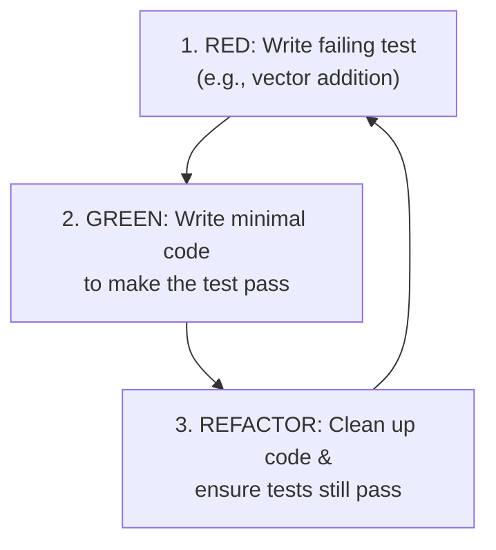

# C++ Raytracer Project

A modern, maintainable C++20 raytracer project scaffold designed with Clean Code, SOLID principles, and Test-Driven Development (TDD) from day one.

---

## Table of Contents

- [Overview](#overview)
- [Project Structure](#project-structure)
- [Cross-Platform Compilation Strategy](#cross-platform-compilation-strategy)
  - [Option A: Dev Container (Recommended)](#option-a-dev-container-recommended)
    - [Using VS Code](#using-vs-code)
    - [Using Zed](#using-zed)
  - [Option B: Native CLI (Linux, macOS, Windows)](#option-b-native-cli-linux-macos-windows)
  - [Option C: Makefile Shortcuts](#option-c-makefile-shortcuts)
- [Running the Hello World Demo](#running-the-hello-world-demo)
- [Test-Driven Development (TDD) & Testing Framework](#test-driven-development-tdd--testing-framework)
  - [Why Catch2 v3?](#why-catch2-v3)
  - [Running the Tests](#running-the-tests)
  - [Catch2 CLI Tricks](#catch2-cli-tricks)
  - [The TDD Workflow: Red-Green-Refactor Walkthrough](#the-tdd-workflow-red-green-refactor-walkthrough)
  - [Catch2 Syntax Cheat Sheet](#catch2-syntax-cheat-sheet)
- [Code Formatting](#code-formatting)
- [Architecture Decisions (ADRs)](#architecture-decisions-adrs)
- [Contributing & Community](#contributing--community)
- [License](#license)

---

## Overview

This repository provides an enterprise-ready foundation for developing a software raytracer:
- **Language**: Modern C++ (C++20).
- **Build System**: CMake (>= 3.22) with `CMakePresets.json` for reproducible builds.
- **Testing**: Catch2 (v3) managed automatically via CMake `FetchContent` (zero manual dependencies to install).
- **Reproducible Environments**: Dev Container configuration compatible with VS Code and Zed.
- **Architectural Separation**: The core raytracing library (`raytracer_core`) is decoupled from the CLI executable (`raytracer`), ensuring all business logic can be unit-tested in isolation without GUI or terminal dependencies.

---

## Project Structure

```text
ray-tracing/
├── .devcontainer/
│   └── devcontainer.json    # Dev Container config for VS Code & Zed
├── .github/
│   ├── workflows/ci.yml     # Automated CI (Build & Catch2 tests via Dev Container)
│   ├── ISSUE_TEMPLATE/      # Standardized bug report & feature request forms
│   └── PULL_REQUEST_TEMPLATE.md
├── .zed/
│   ├── settings.json        # Zed clangd LSP & format settings
│   └── tasks.json           # Zed build & test task runners
├── docs/
│   └── adr/                 # Architecture Decision Records
├── include/
│   └── raytracer/
│       └── app.hpp          # Public API & core domain interfaces
├── src/
│   ├── app.cpp              # Core library implementation
│   └── main.cpp             # CLI application entrypoint
├── tests/
│   ├── CMakeLists.txt       # Test build configuration (Catch2 FetchContent)
│   └── test_greeting.cpp    # Unit test suite demonstrating TDD
├── CMakeLists.txt           # Main build definition
├── CMakePresets.json        # Standard configure/build/test presets
├── Makefile                 # Convenience CLI wrapper
├── .clang-format            # Code formatting style rules
├── CONTRIBUTING.md          # Onboarding and contribution guide
├── CODE_OF_CONDUCT.md       # Community guidelines
├── LICENSE                  # MIT License
└── README.md
```

---

## Cross-Platform Compilation Strategy

To eliminate "works on my machine" issues across student environments (Windows, macOS, Linux), this project uses a two-layer strategy:
1. **Containerized (Dev Container)**: Guarantees identical compiler versions, tools (Ninja, GDB, Valgrind, Clang-Format), and libc across platforms.
2. **Standardized Native (CMake + Presets)**: Provides reproducible native builds without requiring containers when local C++ toolchains are available.

### Option A: Dev Container (Recommended)

Requires [Docker Desktop](https://www.docker.com/products/docker-desktop/) or an equivalent container runtime (e.g. OrbStack, Podman).

#### Using VS Code

1. Install the official **Dev Containers** extension (`ms-vscode-remote.remote-containers`).
2. Open the project folder in VS Code.
3. Click the notification **"Reopen in Container"** (or press `F1` / `Ctrl+Shift+P` / `Cmd+Shift+P`, type `Dev Containers: Reopen in Container`, and press Enter).
4. VS Code builds the Ubuntu-based container, installs the C++ toolchain, and automatically configures:
   - CMake Tools & syntax highlighting
   - Clang-Format on save
   - Catch2 Test Adapter (GUI test runner in the Test explorer)
   - LLDB debugger

#### Using Zed

1. Ensure your container environment is running.
2. Open the workspace folder in Zed.
3. Zed integrates with the provided `.zed/settings.json` and `.zed/tasks.json` for Clangd code completion and tasks:
   - Press `Ctrl+Shift+P` (or `Cmd+Shift+P`) and type `task: spawn`.
   - Select **CMake: Build**, **Run Raytracer**, or **Run Tests (Catch2 Detailed)**.

---

### Option B: Native CLI (Linux, macOS, Windows)

#### Prerequisites

- **C++ Compiler**: GCC 11+, Clang 13+, or MSVC 2019+ (with C++20 support).
- **CMake**: Version 3.22 or newer.
- **Build Generator**: Ninja (recommended) or Make.

#### 1. Using Standard CMake Commands

```bash
# 1. Configure the project in Debug mode
cmake -B build -DCMAKE_BUILD_TYPE=Debug

# 2. Build library, executable, and tests
cmake --build build

# 3. (Optional) Build in Release mode for high-performance renders
cmake -B build-release -DCMAKE_BUILD_TYPE=Release
cmake --build build-release
```

#### 2. Using CMake Presets

```bash
# Configure using preset
cmake --preset default

# Build using preset
cmake --build --preset default
```

---

### Option C: Makefile Shortcuts

A helper `Makefile` is provided for quick terminal commands:

```bash
make help          # View all available targets
make build         # Configure and compile everything
make run           # Run the Hello World application
make test          # Run tests with CTest
make test-verbose  # Run tests with detailed Catch2 assertion output
make clean         # Delete the build artifacts
```

---

## Running the Hello World Demo

Once compiled, the executable is placed in `build/bin/raytracer` (or `build/bin/raytracer.exe` on Windows).

### Direct Execution

```bash
# On Linux, macOS, or Dev Container:
./build/bin/raytracer

# On Windows (PowerShell / Command Prompt):
.\build\bin\raytracer.exe
```

### Or via Make

```bash
make run
```

### Expected Output

```text
Hello, Raytracer!
Bootstrap demo: Canvas initialized at 1280x720 (921600 pixels, aspect ratio: 1.77778)
```

---

## Test-Driven Development (TDD) & Testing Framework

### Why Catch2 v3?

For an educational and production-grade C++ project, **Catch2 v3** was chosen because:
1. **Behavior-Driven Development (BDD)**: Natural `TEST_CASE` and nested `SECTION` structure makes structuring unit tests intuitive. Each `SECTION` executes from the top of the `TEST_CASE`, cleanly resetting state without boilerplate fixture classes.
2. **Self-Documenting Assertions**: Catch2 decomposes expressions automatically. When `REQUIRE(a == b)` fails, it prints the evaluated values of both `a` and `b` without requiring specialized macros like `ASSERT_FLOAT_EQ`.
3. **Zero Host Installation**: CMake downloads and compiles Catch2 automatically via `FetchContent` on the first build.

### Running the Tests

#### Method 1: Using CTest

CTest runs all discovered tests and provides a concise summary:

```bash
ctest --test-dir build --output-on-failure
```

#### Method 2: Running the Catch2 Test Binary Directly

The test binary (`raytracer_tests`) offers powerful diagnostic flags:

```bash
# Run all tests and print full assertion details (useful for learning)
./build/bin/raytracer_tests -s

# Run tests by tag
./build/bin/raytracer_tests "[core]"
./build/bin/raytracer_tests "[math]"

# Run tests matching a specific name pattern
./build/bin/raytracer_tests "Resolution*"

# List all available tests
./build/bin/raytracer_tests --list-tests
```

---

### The TDD Workflow: Red-Green-Refactor Walkthrough

In Test-Driven Development, **no production code is written without a failing test first**.

Here is how you and your team should develop new features (e.g., a `Vec3` 3D vector):



#### Step 1: RED (Write the failing test)

Add a new test in `tests/test_vec3.cpp`:

```cpp
#include <catch2/catch_test_macros.hpp>
#include "raytracer/vec3.hpp"

TEST_CASE("Vec3 vector operations", "[math][vec3]") {
    SECTION("Addition of two vectors") {
        raytracer::Vec3 u{1.0, 2.0, 3.0};
        raytracer::Vec3 v{4.0, 5.0, 6.0};
        raytracer::Vec3 w = u + v;

        REQUIRE(w.x == 5.0);
        REQUIRE(w.y == 7.0);
        REQUIRE(w.z == 9.0);
    }
}
```

Run the build. It should fail to compile or fail the assertion (**RED**).

#### Step 2: GREEN (Write the minimal implementation)

Create `include/raytracer/vec3.hpp`:

```cpp
#pragma once

namespace raytracer {

struct Vec3 {
    double x{0.0};
    double y{0.0};
    double z{0.0};

    constexpr Vec3 operator+(const Vec3& other) const noexcept {
        return {x + other.x, y + other.y, z + other.z};
    }
};

} // namespace raytracer
```

Add the test file to `tests/CMakeLists.txt`, build, and run `make test`. All tests pass (**GREEN**).

#### Step 3: REFACTOR (Improve design with confidence)

Refactor to add operator overloads (`+=`), bounds checking, or SIMD optimizations. Re-run `make test` to verify nothing broke.

---

### Catch2 Syntax Cheat Sheet

| Macro | Description | Example |
| :--- | :--- | :--- |
| `TEST_CASE("name", "[tag]")` | Defines a test suite with optional tags | `TEST_CASE("Ray-sphere intersection", "[geometry]")` |
| `SECTION("scenario")` | Isolates an independent branch of execution | `SECTION("Ray misses sphere") { ... }` |
| `REQUIRE(condition)` | Asserts condition; **stops** test if false | `REQUIRE(sphere.radius() > 0.0);` |
| `CHECK(condition)` | Asserts condition; **continues** test if false | `CHECK(pixel.r >= 0.0);` |
| `REQUIRE_THAT(val, Matcher)` | Floating point / string matching | `REQUIRE_THAT(val, Catch::Matchers::WithinRel(1.0, 0.001));` |

---

## Code Formatting

Code style is enforced using `.clang-format` based on the Google C++ style guide.

To format all files manually:

```bash
# Format header and source files
clang-format -i include/raytracer/*.hpp src/*.cpp tests/*.cpp
```

In VS Code and Zed, **Format on Save** is enabled by default in the workspace settings.

---

## Architecture Decisions (ADRs)

Key architectural choices (build tools, libraries, CI infrastructure) are tracked as Architecture Decision Records in [`docs/adr/`](file:///c:/Users/ADSL/Documents/Administratif/école/ray-tracing/docs/adr/). Review existing ADRs before introducing new tools or altering configurations. To propose a change, create a new record with status `Proposed`.

---

## Contributing & Community

We welcome outside contributions! Please read our onboarding documentation:
- [CONTRIBUTING.md](file:///c:/Users/ADSL/Documents/Administratif/école/ray-tracing/CONTRIBUTING.md) for environment setup, `make` workflows, and TDD guidelines.
- [CODE_OF_CONDUCT.md](file:///c:/Users/ADSL/Documents/Administratif/école/ray-tracing/CODE_OF_CONDUCT.md) for community expectations.
- Issue and Pull Request templates are provided in `.github/`.
- CI builds and runs Catch2 unit tests automatically inside the Dev Container on every PR via [ci.yml](file:///c:/Users/ADSL/Documents/Administratif/école/ray-tracing/.github/workflows/ci.yml).

---

## License

This project is licensed under the MIT License - see the [LICENSE](file:///c:/Users/ADSL/Documents/Administratif/école/ray-tracing/LICENSE) file for details.
