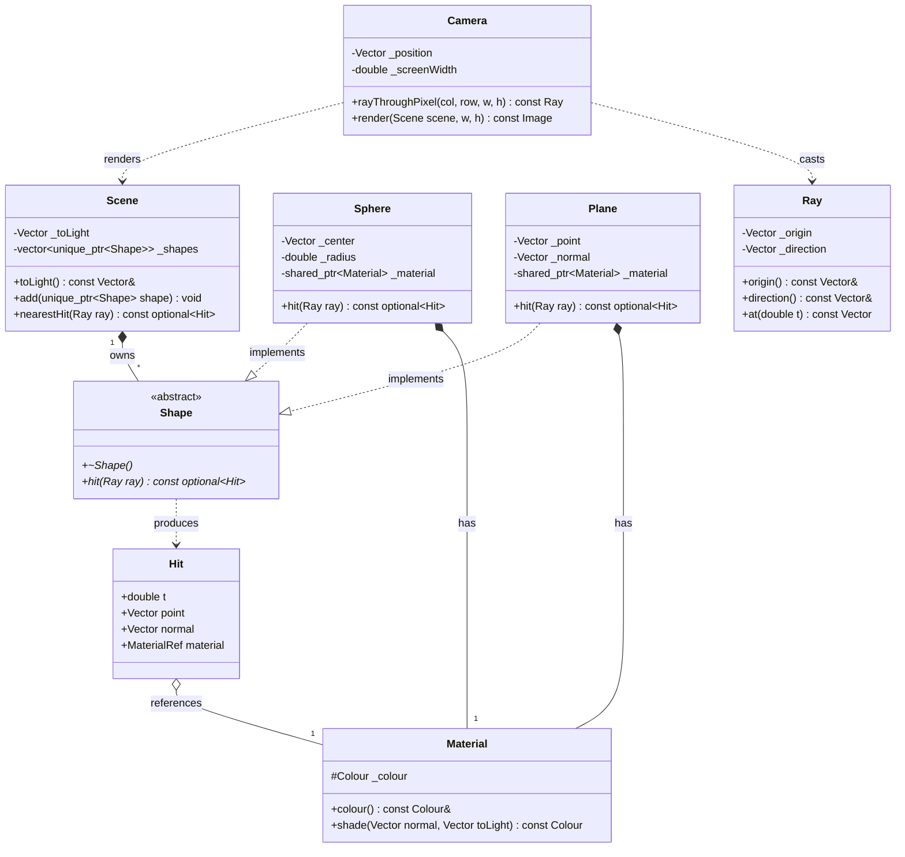

# Domain Model

### Key Relationships
- **Scene**: Owns any number of `Shape`s via `std::unique_ptr<Shape>` and holds the sun's direction (`toLight`).
- **Shape**: Abstract interface with pure virtual `hit(ray) const`.
- **Sphere & Plane**: Concrete shapes implementing `Shape`.
- **Material**: Encapsulates surface appearance and Lambertian shading ($N \cdot L$).
- **Composition**: Shapes *have* a `Material` rather than subclassing it ($\text{Shapes} + \text{Materials}$ instead of $\text{Shapes} \times \text{Materials}$).
